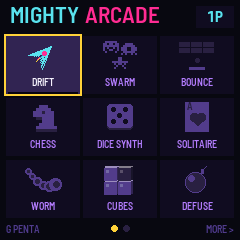
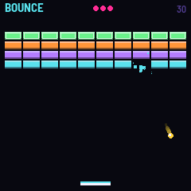

# Mighty Arcade for the M-VAVE FM-1

Custom firmware for the M-VAVE FM-1. Mighty Arcade, from the creator of Mighty Arp, is eighteen casual games that
make generative music as you play. Every game is a sequencer: the board, the cards, the balls you sink and the
creatures you catch are the notes, a playhead plays them in time, and the drums come in as you get further.

  

## The games

| Page 1 | | |
| --- | --- | --- |
| **BOUNCE**: break the wall; a playhead plays its columns | **SWARM**: shoot the swarm; each catch lands in an eight-step loop | **DRIFT**: steer among rocks; a radar sweep plays them |
| **CHESS**: against the computer or a friend; the board is the score | **DICE SYNTH**: roll a new FM sound and play it on the keys | **SOLITAIRE**: Klondike; the columns are an ambient sequencer |
| **WORM**: a worm on the beat, playing every note it has eaten | **CUBES**: pop colours and free the note gems | **DEFUSE**: clear the field; the numbers you open are the tune |

| Page 2 | | |
| --- | --- | --- |
| **GOLF**: three courses of nine; every bank is a note | **PINBALL**: a two-screen table; the bumpers play the chord | **DODGE**: a rolling marble in a box of note tiles |
| **DARK**: turn every light off as the music quiets | **DROP**: drop balls through tilting platforms (the knobs tilt them) | **POOL**: sink the balls; each pocket is a note in the loop |
| **ROWS**: four in a row; each column is a note | **2048**: merge tiles up the scale | **CHECKERS**: every move and jump lands on its note |

## Quick start

1. **The controls are a game pad.** Your left hand plays the pad on the lowest keys (**F3** left, **F#3** up,
   **G3** down, **A3** right) and your right hand presses **F5** to select (the games' hints call it the TOP KEY).
   Only the keys a game uses light up.
2. **Pick a game** from the menu: two pages of nine, right off the edge for the second. **HOME** comes back from any
   game. Up from the top row is the **PLAYERS** switch: 1, or 2 taking turns.
3. **In the menu**, **PRESET** sets the scale and **ALGORITHM** the key for every game.
4. **In the sequencer games**, **KNOB 1** is the tempo, **KNOB 2** the chance a note sounds, **KNOB 3** the sound and
   **KNOB 4** how loud the game's effects are. Turn it to 0 and only the music plays.

Mighty Arcade also gives the [FM-1 Screen Reader](https://charlesvestal.github.io/fm1-reader/) the words on its
screen.

## Building and testing

Mighty Arcade is an app (`app/`, the sound in `app/dsp/`, Mighty Arp's engine) on
[fm1-base](https://github.com/charlesvestal/fm1-base) (`base/`, a git submodule); clone with `--recursive`. The
toolchain is the same as Mighty Arp's.

```
./build.sh                                                     # app/build/mightyarcade.fwsc
python3 base/tools/fm1_install.py app/build/mightyarcade.fwsc  # install it over USB
./build.sh --host                                              # the app in the simulator
for t in app/tests/*.txt; do app/build/host/mightyarcade_host $t /tmp/out || echo FAIL $t; done
sh app/tests/levels.sh                                         # DROP's and DODGE's levels
./build.sh --web                                               # the browser emulator, in app/build/emu/
```

Installing it is at your own risk, though it's hard to get stuck: fm1-base's installer can put M-VAVE's own firmware
back, and an FM-1 that fails to start twice comes up in a safe mode the installer can reach.

## Credits

Mighty Arcade is by Nick Culbertson. The chord voicings are his own, from his Macro MIDI Pad, and the sound engine
is Mighty Arp's. It is built on [fm1-base](https://github.com/charlesvestal/fm1-base) by Charles Vestal and
[felucca-bsp](https://github.com/hugelton/felucca-bsp), from [Felucca](https://github.com/hugelton/Felucca) by Leo
Kuroshita (Hügelton Instruments). MPL-2.0; see [LICENSING.md](LICENSING.md).

M-VAVE and FM-1 are trademarks of their owners. Mighty Arcade is not affiliated with M-VAVE or Hügelton Instruments.

This project was developed with AI assistance.
