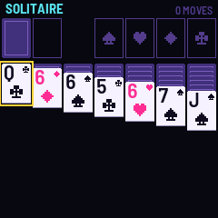
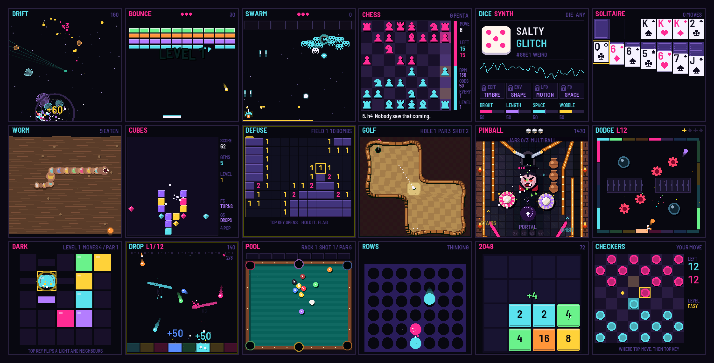

# Mighty Arcade for the M-VAVE FM-1

Mighty Arcade, from the creator of Mighty Arp, is custom firmware for the M-VAVE FM-1. It’s 18 music-making games, each built around a generative sequencer. The board, the cards, the balls and the creatures all work together to make music while you play.

- **Try it in your browser** (no FM-1 needed): <https://nickculbertson.github.io/FM1-Mighty-Arcade/emu/>
- **Install it** (Chrome or Edge, with the FM-1 plugged in): <https://nickculbertson.github.io/FM1-Mighty-Arcade/install/>

  

## The Games



| Page 1 | | |
| --- | --- | --- |
| **DRIFT**: steer among rocks, a radar sweep plays them | **BOUNCE**: break the wall, a playhead plays its columns | **SWARM**: shoot the swarm, each catch lands in an eight-step loop |
| **CHESS**: against the computer or a friend, the board is the score | **DICE SYNTH**: roll a new FM sound and play it on the keys | **SOLITAIRE**: Klondike, the columns are an ambient sequencer |
| **WORM**: a worm on the beat, playing every note it has eaten | **CUBES**: pop colors and free the note gems | **DEFUSE**: clear the field, the numbers you open are the tune |

| Page 2 | | |
| --- | --- | --- |
| **GOLF**: three courses of nine, every bank is a note | **PINBALL**: a two-screen table, the bumpers play the chord | **DODGE**: a rolling marble in a box of note tiles |
| **DARK**: turn every light off as the music quiets | **DROP**: drop balls through tilting platforms (the knobs tilt them) | **POOL**: sink the balls, each pocket is a note in the loop |
| **ROWS**: four in a row, each column is a note | **2048**: merge tiles up the scale | **CHECKERS**: every move and jump lands on its note |

## Quick start

- **Play:** the lowest keys are the pad (**F3** left, **F#3** up, **G3** down, **A3** right); **F5** selects.
  **EDIT** shows every control for the game on screen.
- **Menu:** two pages of nine. **HOME** comes back from any game; up from the top row picks 1 or 2 players.
- **Music:** **PRESET** sets the scale and **ALGORITHM** the key, for every game. In the sequencer games the knobs
  are tempo, chance, sound and effects volume.

Mighty Arcade also gives the [FM-1 Screen Reader](https://charlesvestal.github.io/fm1-reader/) the words on its
screen.

## Building and testing

Mighty Arcade is an app (`app/`, the sound in `app/dsp/`, Mighty Arp's engine) on
[fm1-base](https://github.com/charlesvestal/fm1-base) (`base/`, a git submodule); clone with `--recursive`. The
toolchain is the same as Mighty Arp's.

```
./build.sh                                                     # app/build/mightyarcade.fwsc
python3 base/tools/fm1_install.py app/build/mightyarcade.fwsc  # install it over USB
./build.sh --host                                              # the app in the simulator
for t in app/tests/*.txt; do app/build/host/mightyarcade_host $t /tmp/out || echo FAIL $t; done
sh app/tests/levels.sh                                         # DROP's and DODGE's levels
./build.sh --web                                               # the browser emulator, in app/build/emu/
```

Installing it is at your own risk, though it's hard to get stuck: fm1-base's installer can put M-VAVE's own firmware
back, and an FM-1 that fails to start twice comes up in a safe mode the installer can reach.

## Credits

Mighty Arcade is by Nick Culbertson. The chord voicings are his own, from his Macro MIDI Pad, and the sound engine
is Mighty Arp's. It is built on [fm1-base](https://github.com/charlesvestal/fm1-base) by Charles Vestal and
[felucca-bsp](https://github.com/hugelton/felucca-bsp), from [Felucca](https://github.com/hugelton/Felucca) by Leo
Kuroshita (Hügelton Instruments). MPL-2.0; see [LICENSING.md](LICENSING.md).

M-VAVE and FM-1 are trademarks of their owners. Mighty Arcade is not affiliated with M-VAVE or Hügelton Instruments.

This project was developed with AI assistance.
