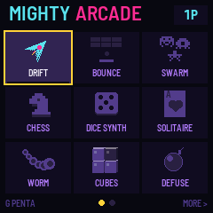

# Mighty Arcade

Custom firmware for the M-VAVE FM-1. Mighty Arcade, from the creator of Mighty Arp, is eighteen music-making games: chess and solitaire, pinball and golf, arcade games and puzzles. Every game is a
sequencer: the board, the cards, the balls you sink and the creatures you catch are the notes.

Version {{VERSION}}. Installing is at your own risk; the installer can put M-VAVE's own firmware back.

- [Try it in the browser](emu/): the same code the FM-1 runs, with sound. No FM-1 needed.
- [Install](install/): from Chrome or Edge, with the FM-1 connected by USB.
- [Download {{PKG}}](firmware/{{PKG}}): for the command-line installer in
  [fm1-base](https://github.com/charlesvestal/fm1-base), `python3 tools/fm1_install.py {{PKG}}`.
- [Source](https://github.com/NickCulbertson/FM1-Mighty-Arcade): MPL-2.0. Built on
  [fm1-base](https://github.com/charlesvestal/fm1-base) by Charles Vestal and felucca-bsp, from Felucca by Leo
  Kuroshita, Hügelton Instruments.

M-VAVE and FM-1 are trademarks of their owners. Mighty Arcade is not affiliated with M-VAVE.
